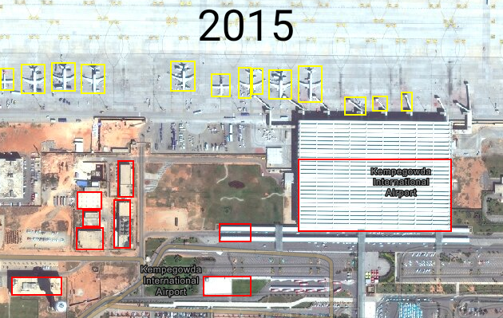
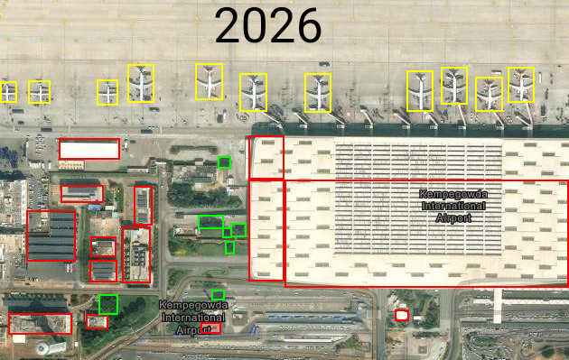
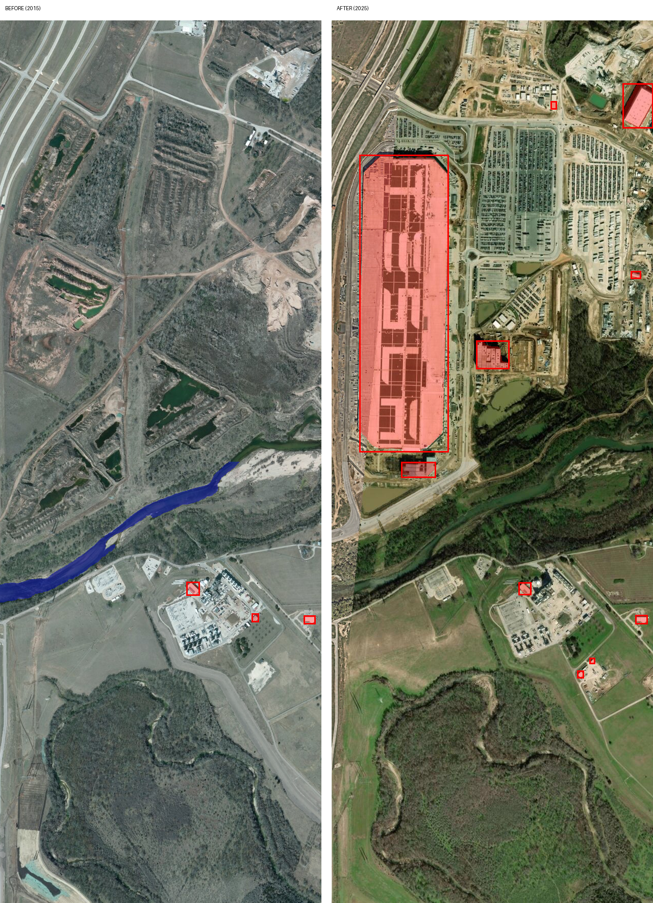

# Time-Fold: AI that measures change from satellite history, then audits its own measurements

Time-Fold takes two satellite views of the same place from different years and
turns them into evidence about what changed. **SAM 3.1 measures** (finds objects
and outlines areas), then **Muse Spark audits** those measurements against the
images, flags what looks wrong, and writes a short, honest report.

Built for the **Meta Global AI Developer Hackathon**, Indie Developer track,
**Push the Frontier** theme (helping people understand a physical system, here
the changing land around us).

- Demo video: TODO add your YouTube link
- Models: SAM 3.1 and Muse Spark 1.2 through the Meta Model API

## Why
Satellite history exists for almost everywhere, but reading it takes expertise,
and automatic detectors make mistakes that are easy to miss. Time-Fold gives a
plain-language summary of what changed and says how far the automatic
numbers can be trusted.

## What makes this more than an image describer
1. 1. **It measures.** SAM 3.1 returns boxes and pixel masks, so every class it can
   find (for example buildings) gets a count and a true area share, per year.
   Where it fails, the audit says so.
2. **It audits itself.** Spark receives the original images **and** the
   detection overlays, and has to say which results look right, which look wrong,
   and whether a large structure was missed.
3. **It is honest about uncertainty.** Causes are labelled as hypotheses, the 2050
   text is a scenario with stated assumptions (not a prediction), and the report
   ends with confidence and limits.

## How it works
1. Two screenshots of the same place (different years) go in.
2. Each image is analysed at several scales: the whole image for large objects,
   and enlarged tiles for small ones.
3. **SAM 3.1** (Meta Model API, `/responses`) returns boxes and masks for each
   prompt, for example "building", "parking lot", "river".
4. Masks are decoded with Meta's open-source `meta-sam-parser` package, merged
   across tiles, and turned into counts and area shares.
5. Colored overlays are drawn on both images, and a side-by-side picture is saved.
6. **Muse Spark** (Meta Model API, `/chat/completions`) receives the originals,
   the overlays and the numbers, and writes the report: verification, what
   changed, a 2050 scenario, confidence and limits.
7. Every API result is cached locally, so re-running the same images is free.

## Examples

- ### 1. Kempegowda International Airport, Bengaluru (2015 vs 2026)
Produced with the earlier box-based version (`Timefold.py`).

- SAM's rough box-based results: building count 9 to 14 and building area share
  about 0.10 to 0.22. Airplane count 13 to 11. Car count 0 to 0. Tree count 0 to 7.
- Spark's audit judged most of these counts unreliable: building counts are inflated
  because the main terminal is one box in 2015 but three boxes in 2026; three small
  "airplanes" in 2015 are actually jet bridges; the car count of 0 is wrong because
  many vehicles are visible in the parking areas; and the "trees" are fragmented
  boxes on vegetation patches, not individual trees.
- What Spark judged trustworthy from the images: the terminal roof footprint
  expanded substantially westward, and former bare soil and construction land west
  and northwest of the terminal is now built up (new large white-roof hangar and an
  expanded dark-roof complex), with more landscaping. Confidence: moderate.
- Files: `before_annotated.png`, `after_annotated.png`, `report.txt`, `stats.json`

### 2. Tesla Gigafactory Texas, Austin (2015 vs 2025)

- Before: excavated pits with small ponds.
- After: a very large factory building with a TESLA pattern on its roof, large parking and trailer staging areas, and new access roads.
  with rooftop solar panels, large parking and trailer staging areas, and new
  access roads. The Colorado River and the forest south of the site look largely
  unchanged, which is a useful sanity check.
- Lesson from an early run: SAM found the smaller buildings but **missed the huge
  factory roof**, because tiling cut it into slices. That led to the multi-scale
  design and to Spark being asked to check specifically for missed large structures.
- Latest mask-based run, as audited by Spark: SAM covered the main factory well
  (area share about 0.1% in 2015 to about 9.4% in 2025; count 3 to 10, which
  under-segments small sheds). Spark flagged that SAM missed the parking lots,
  vehicles, new ponds and most roads, and outlined the river only in 2015 even
  though it is still there, so those numbers are not usable.
- Spark's reading of the change: bare quarried scrub in 2015 became a long factory
  building with a TESLA roof pattern, plus new paved lots and roads to the east and
  northeast. The area south of the river is stable and works as a sanity check. A
  visible stitching seam crosses the 2025 image near the river.

## Limitations (stated honestly)
- Detections and areas are indicative, not ground-truthed.
- SAM works best on countable objects. It can miss or mislabel wide areas, and
  small objects such as individual cars and trees are often missed.
- Screenshots can be stitched from imagery of different dates. Seams are visible
  in the Gigafactory "after" image.
- Two images cannot prove causes or trends. Causes in the report are hypotheses.
- The 2050 text is a qualitative scenario, not a forecast.
- The output is not legal evidence and must not be used to accuse anyone.

## Imagery
Screenshots come from TODO name the map or imagery provider and its date labels.
Imagery belongs to its provider and is used here only to demonstrate the method.
Check the provider's terms before reusing it.

## Repository
- `timefold_full.py`: current version (multi-scale SAM, mask-based area, Spark audit)
- `Timefold.py`: earlier box-based version used for the airport example
- Example outputs: annotated images, side-by-side picture, `report.txt`, `stats.json`
- `LICENSE`: MIT

## Run it (Google Colab, works from a phone)
1. Open Google Colab and create a new notebook.
2. Upload your two screenshots (folder icon, or `files.upload()`). Run `!ls` to
   check the exact file names.
3. Paste the whole of `timefold_full.py` into one cell.
4. Edit only the **settings block**: your API key, the two image names, the two
   **real capture years**, and the place name.
5. Run the cell. Results are saved next to the notebook and downloaded.

**Never commit your real API key.** Keep `API_KEY = "PASTE_YOUR_KEY_HERE"` in the repo.

## Built during the hackathon
All code in this repository was written during the hackathon building period
(Oct 27 to Nov 4, 2026): the SAM and Spark pipeline, tiling and multi-scale
detection, mask decoding and area measurement, overlays, caching and the report
prompts. TODO confirm: any earlier map-interface prototype is not part of this repo.
Parts of the code were written with the help of an AI assistant.

## Roadmap
- Open satellite sources (Landsat, Sentinel) so no screenshots are needed
- A simple web interface
- Repeated checks across more years, and more places

## Author
Kemparaju S, Chamarajanagar, Karnataka, India
